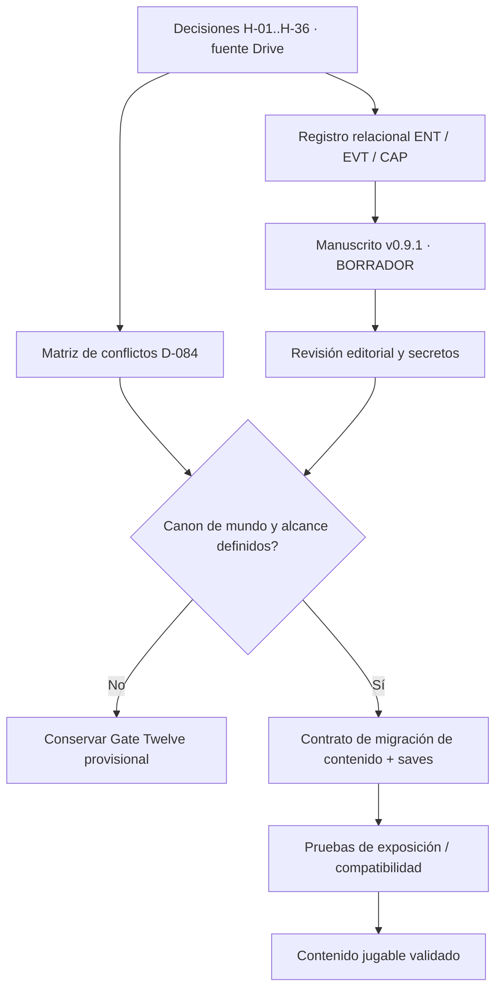

# D-084 — Puente de continuidad: canon de Drive → THE GAME jugable

**Fecha:** 2026-10-26 (AST)  
**Clase:** análisis de integración documental, **NO implementación**.  
**Estado:** PROPUESTA / revisión; no reemplaza el manuscrito ni crea canon.  
**Paquete hermano:** [matriz de procedencia D-084](D084_CANON_PROVENANCE_MATRIX_2026-10-26.md).  
**Base GitHub inspeccionada:** `docs/master-game-development-program` @ `dac5d22cdbe211d0d35d3df98b542be2653f1b85`.

## 1. Hallazgo que cambia el plan

En Google Drive **ya existe** la historia literaria original en `THE GAME — Historia novelada — Volumen I: La era de las rupturas`. En la primera lectura se encontraba en **BORRADOR v0.8** (~115 mil caracteres); la lectura más reciente **2026-10-27** confirma **BORRADOR v0.9.1**, doce secciones I–XII, nota histórica XIII, y una adaptación puntual de la escena compuesta DR-06 en el capítulo XII. **No escribir un nuevo Volumen I paralelo en GitHub**, ni tratar esa escena provisional como evento real de la historia. Este documento no compite con ese manuscrito: define cómo podría alimentarse el diseño del videojuego una vez resueltos canon, conocimiento del jugador, identidad y compatibilidad de contenido.

Fuentes narrativas recuperadas, con función distinta y sin copiar URL privadas al repositorio público:

| Etiqueta | Fuente Drive (título identificable) | Papel | Estado de autoridad |
| --- | --- | --- | --- |
| CAN | THE GAME — Historia original prioritaria — 2026-10-10, con H-01–H-36 hasta 13 de octubre | Hechos expresos del creador | Prioridad narrativa; canon técnico aún sin migración formal |
| CEN | THE GAME — Centro de Historia y Canon — Leer Primero (2026-10-13) | Lectura/decisiones/procedencia | Índice, no canon paralelo |
| REL | THE GAME — Registro histórico relacional — Eventos, entidades, vínculos y capítulos (v1.6 y adiciones 2026-10-27) | ENT, EVT, REL, CAP, colisión NOV-XII y cotejo de dos borradores | Trazabilidad de la novela, con historial de revisiones anteriores |
| NOV | THE GAME — Historia novelada — Volumen I — BORRADOR v0.9.1 (2026-10-27) | I–XII narrativa y XIII Nota del archivo; adaptación DR-06 incluida como escena compuesta | **BORRADOR**, no contenido jugable aprobado |
| WAR | THE GAME — Dossier de la Primera Guerra — fuentes y continuidad (2026-10-15) | Riesgos R-WAR y continuidad bélica | Investigación, no canon |
| DISC | THE GAME — Matriz de conocimiento y divulgación del estallido (2026-10-14) | Narrador/seres humanos/invasores/secretos | Propuesta editorial, no acceso de NPCs confirmado |
| QH | THE GAME — Cuestionario maestro de historia — Q&A por etapas | Preguntas aún no resueltas | Herramienta, no decisiones nuevas |
| ♾ | THE GAME — Continuidad contextual, permisos y retoma — Leer Primero (2026-10-13) | Interpretación de continuidad autónoma | Permisos/retoma; no habilita identidad Player-AI suspendida |

**Hallazgo sobre calendario — verificado con fuente primaria 2026-10-27:** WAR condujo al original `WORLD_CAUSALITY_ATLAS_2670_V1.json` y su par `.md`, localizados y leídos directamente en la biblioteca del usuario. El JSON consta de 542 líneas, revisión 2 del 2026-08-23, y se autodefine como **referencia causal de una campaña original de chat**, no como canon técnico de este repositorio. Contiene una guerra intermundial humano/Kharvori 2645–2659, el acuerdo Halcyon de 2660 y snapshot de 2670. **Esas fechas existen en esa fuente, pero su pertenencia a H-36 no está probada.** Importa distinguir *primera apertura* (H-36) de *expansión posterior de portales* (atlas): una secuencia de expansión posterior no contradice por sí sola la simultaneidad inicial. **No migrar** fechas, bandos, nombres, coordenadas, población ni relaciones de Jack a este juego por parecido. Restan pruebas de identidad y adopción, no buscar el archivo otra vez. Véase auditoría LA-01..LA-06 en la matriz hermana.

## 2. Reconciliación con el producto actual

Lectura puntual real de `content/vertical_slice_01.json` en la rama autoritativa:

- `content_id = CONTENT_VERTICAL_SLICE_01`; `canon_status = provisional_canon`.
- Apertura `OPENING_DEPOT_BLACKOUT` con flags de estado `world.trace_echo_quest_started` y otros flags locales.
- Contiene `NPC_TAMSIN` con `knowledge`, `memories`, `goals` y `story_state` separadas en el estado inicial.
- `docs/world/WORLD_CANON_DECISION_QUEUE.md` registra Gate Twelve y lugares del distrito, además de WD-001 (identidad y emplazamiento), WD-002 (tecnología/física global) y decisiones relacionadas sin resolver.
- `docs/systems/SOCIAL_SCHEMA_API_MIGRATION_PACKET.md` (D-062) define separación de conocimiento de jugador/NPC, persistencia, visibilidad y migración **como diseño**, no como permiso de reescribir la historia de Tamsin.

**Conclusión operativa:** la ficción original del mundo de cristales no está incorporada automáticamente en esa apertura. No es válido tratar escenas Gate Twelve como evidencia de H-01–H-36 o inyectar el nuevo canon mediante una búsqueda/sustitución de strings. Hace falta un contrato de migración o una separación explícita de campañas, según decisión editorial.

## 2A. Conexión comprobada de los capítulos al juego — v0.9.1

**Lectura Drive 2026-10-27:** el volumen tiene **doce secciones de prosa** y XIII «Nota del archivo histórico». Los ID `NOV-*` son identificadores editoriales de la obra, **no IDs de misiones, escenas, lugares o nodos de estado**. Los `CAP-*` son planes de cobertura del registro relacional, no aprobación de eventos. Esta tabla es un **crosswalk de dependencias para futuras revisiones** y no traslada los capítulos como textos secretos al juego.

| Sección de la novela | Materia y fuentes narrativas (ver CAN/REL) | Riesgo de integración / gate concreto |
| --- | --- | --- |
| I «El mundo anterior» | Contexto humano anterior a la crisis; H-28/H-29, EVT-001 | No usar «como 2026» como año canónico, ni convertir recuerdos generales en geografía. |
| II «Cuando la explicación dejó de alcanzar» | Portales, fisuras y límites de comprensión; H-08/H-15/H-30, EVT-003/004 | Narrador omnisciente ≠ diálogo de NPC informado de cosmología. |
| III «Lo que atravesó las rupturas» | Bestias y núcleos previos; H-09/H-10/H-16 a H-18, EVT-005/008 | Separar bestias evolucionadas de invasores inteligentes; no codificar ciclo evolutivo imaginado. |
| IV «El principio de una adaptación» | Sistema, capacidades y primeros aprendizajes; H-03 a H-06/H-11 a H-13, EVT-006/007 | No confundir orden narrado con la concurrencia real de Sistema y primeras aperturas (H-36). |
| V «El estallido sin preparación» | Concurrencia, sorpresa y experiencia humana; H-32 a H-36, EVT-003/004/005/006/012 | Eventos de la misma fase, sin microorden o ubicación fabricada. |
| VI «Cuando el mundo tuvo que contarse a sí mismo» | Conocimiento público desigual; H-30/H-32 a H-36, KNO-001/M-01..M-07 | Requiere procedencia de información en NPC/journal; no regalar secretos al entrar a una escena. |
| VII «La materia que el mundo no sabía nombrar» | Cristales y aplicaciones humanas; H-11/H-16/H-19 a H-27, EVT-007 | No transformar ejemplos narrativos en recetas, estadísticas ni fecha de primera forja. |
| VIII «De sobrevivir a resistir» | Adaptación y camino hacia defensa; H-05/H-06/H-12/H-33/H-36, EVT-006/007/009 | No inventar organización militar, mando, batalla, victoria o calendario. |
| IX «El valor de permanecer» | Necesidades materiales, territorio, tregua; H-12/H-13/H-28 a H-30, EVT-009/010 | Ilustraciones logísticas como **propuestas**, no rutas físicas o instituciones autorizadas. |
| X «Donde empieza una guerra» | Primera Guerra y decisiones humanas en borrador; H-12/H-13, EVT-009/010 | Escribir causalidad propuesta no fija años 2645–2659 ni bandos Kharvori. |
| XI «El silencio que no era paz» | Tregua territorial y continuidad; H-13, EVT-010/011 | Ningún cese de hostilidades prueba desaparición de bestias ni acuerdos con ellas. |
| XII «El oficio de volver a vivir» | Vida civil, restablecimiento de suministros, memoria y trabajo; H-05/H-06/H-11/H-13/H-16/H-28 a H-30, EVT-009/010/011 | La **adaptación DR-06** (reparación, reservas, verificación y solicitudes) es **escena compuesta identificada como PROPUESTA**; no convertirla en NPC, centro de abastecimiento, almacén, misión o sistema económico. |
| XIII «Nota del archivo histórico» | Control de perspectiva y límites de certeza, no capítulo narrativo adicional | No tratar nota editorial como evento diegético ni duplicar capítulo XII. |

### Colisión y reconciliación de procedencia editorial

- **Presente en el manuscrito:** `NOV-XII-MANUSCRITO-v0.9.1` — «El oficio de volver a vivir» (sección XII). Apéndice final v0.9.1 confirma `DR-06-ADAPTADO` y subraya la **ficción de la escena**.
- **Fuente independiente conservada:** `NOV-XII-DR06-BORRADOR-v0.1` — «Lo que debía seguir funcionando». El texto original permanece separado y no se elimina tras la adaptación.
- **Historial del Registro relacional:** REL contiene una comparación hecha **antes** de la integración acotada, cuando advertía que no se había integrado DR-06. Leer el documento actual más su anexo de conciliación para no tratar una observación históricamente correcta como estado vigente.
- **Contrato de vínculo:** de `H-##` confirmado a `EVT-##` de REL, de ahí a `NOV-##` editorial; del manuscrito al RPG **solo** mediante una decisión de adopción de contenido con alcance, identidad de campaña, consentimiento editorial, conocimiento autorizado y pruebas de persistencia. Una coincidencia temática **no crea enlace jugable**.

**Criterios de aceptación de esta revisión:** (a) no se declara NOV XII como canon, (b) se conserva el manuscrito único y el archivo alternativo sin sobreescribirlos, (c) la cronología del estallido es concurrente, (d) todo contenido DR-06 y propuestas P quedan fuera del engine hasta aprobación, (e) Gate Twelve permanece contenido `provisional_canon`.

## 3. Matriz de consumidores y límites de implementación

| Dependencia narrativa | Contrato a acordar primero | Consumidor futuro (propuesta, no código confirmado) | Criterio de protección |
| --- | --- | --- | --- |
| H-36: estallido simultáneo | `STORY_EVENT` estable con cinco subeventos concurrentes y una **etiqueta de fase**, sin inventar fecha, lugar o microorden | Referencias de historia, lector de lore, contenido de quests | No generar cinco timestamps necesariamente diferentes o secuencias no aprobadas |
| H-03/H-04: origen Sistema/tableta | Identidad de `secret_fact` y política de revelación por progresión | Player projection, journal, NPC knowledge | La tableta no aparece en HUD/diálogo/inventario inicial sin descubrimiento autorizado |
| H-05/H-06: habilidad principal aleatoria | Autoridad de asignación, subhabilidades y migración de progreso definida por D-032 / D-061 y padres | Motor de progresión, Android Stats | No convertir Trace Echo/Steal en una equivalencia sin decisión; no sumar habilidades principales |
| H-09/H-10/H-16: bestias y núcleos | Taxonomía de bestia separada de invasores, provenance del core, evolución propuesta | Bestiario, loot, crafting, NPCs | No adjudicar humanoides automáticamente a invasores ni instanciar etapas numéricas no aprobadas |
| H-11/H-19–H-27: forja | Destino de atributo, tipo de core, habilidad Smith, guardarraíl de duplicación de buffs | Ítems/recetas/balance | No escribir formulas ni craft instantáneo sin diseño aprobado |
| H-12/H-13: Primera Guerra y tregua | Timeline parcial de estado de mundo y facciones; años solo con fuente propia | Quest history, mapas políticos, codex | No firmantes, vencedor, mapa de fronteras o cronología derivados de otro proyecto |
| H-28–H-31: presentación histórica | Política `author_known` / `public_known` / `player_discovered` / `npc_known` | Contenido narrativo, bridge, Android UI | Omnisciencia literaria != conocimiento del jugador |

La tabla es una **agenda de contratos**, no afirma que las estructuras o claves propuestas (`STORY_EVENT`, `secret_fact`, etc.) existan ya en el motor.

## 4. Grafo mínimo de dependencias para el programa

**Precondición de esta ruta:** el historial del Drive no sustituye la autoridad de implementación actual del repositorio. Las decisiones editoriales deben atravesar revisión de estado, schemas y pruebas antes de crear mecánicas.

## 5. Pruebas futuras especificadas, NO ejecutadas

| ID | Escenario a convertir en prueba cuando exista implementación | Resultado esperado |
| --- | --- | --- |
| INT-01 | Importación de cinco eventos H-36 del mismo estallido | Pertenecen a una fase común y no se les asigna orden histórico ficticio |
| INT-02 | Proyección inicial de nuevo jugador sin conocimiento secreto | Tableta y origen oculto no filtrados en vistas públicas/Android |
| INT-03 | NPC sin conocimiento de tableta realiza diálogo habitual | No puede revelar lo no aprendido; otro campo privado tampoco se expone |
| INT-04 | Save antiguo de Gate Twelve antes/después de migración consensuada | IDs previos preservados o migrados explícitamente; no pérdida silenciosa |
| INT-05 | Habilidad principal preexistente | No se duplica ni fusiona con otra identidad al aplicar H-05 |
| INT-06 | Registro de invasor y criatura evolucionada | Son tipos separados; no comparten por defecto rol político ni progresión |
| INT-07 | Evento guerra/tregua con campos desconocidos | Falta de año, firmantes o coordenadas no se rellena con valores inventados |
| INT-08 | Borrador NOV v0.9.1 en corpus de contenido | No se expone automáticamente como escena/journal canon; revisión requerida |
| INT-09 | Ingesta de atlas viejo con fechas de guerra 2645–2659/2660 y metadatos de campaña | Debe permanecer HISTORICAL/UNLINKED hasta comprobación de continuidad; ni años ni bandos se convierten en hechos H-12/H-13 |
| INT-10 | Atlas menciona expansión de portales, canon H-36 exige primer estallido simultáneo | La validación distingue ‘initial opening’ de ‘later expansion’ y no infiere contradicción automática ni altera el orden de H-36 |
| INT-11 | Entrada legada interpreta AC = After Crystal | Debe quedar marcada SUPERSEDED ante directiva del creador AC = Antes del Crystal, sin calcular años del presente jugable |

| INT-12 | Ingesta/índice editorial encuentra dos trabajos etiquetados NOV-XII | Exigir `NOV-XII-MANUSCRITO-v0.9.1` o `NOV-XII-DR06-BORRADOR-v0.1`; rechazar el identificador sin calificador como ambiguo |
| INT-13 | Escena compuesta `DR-06-ADAPTADO` incluida en v0.9.1 se analiza para contenido | Estado `PROPUESTA/EDITORIAL` preservado; no se crean NPC, sitio, ruta, inventario, quest ni economía automáticamente |
| INT-14 | Revisión de un manifiesto narrativo generado desde una versión obsoleta (v0.8/v0.9) | Detectar divergencia con encabezado actual v0.9.1 y exigir nuevo cotejo de fuente, sin sobrescribir capítulos por índice |

Estas pruebas son **criterios propuestos**, no archivos test añadidos ni reportes PASS de ejecución.

## 6. Riesgos y próximos pasos sin solapamientos

1. **Calendario:** los archivos principales `WORLD_CAUSALITY_ATLAS_2670_V1.json` / `.md` están **localizados y leídos** en la biblioteca; rastrear ahora el vínculo de continuidad que justificaría adoptar sus fechas en H-36. Si no existe evidencia suficiente, conservar sus fechas solo como cronología de la campaña antigua.
2. **Manuscrito:** seguir trabajando en NOV v0.9.1 y REL (v1.6 con entradas del 2026-10-27) en su continuidad Drive autorizada; **no** crear un segundo Volumen I en GitHub ni reutilizar el identificador genérico ambiguo NOV-XII.
3. **Identidad planetaria:** conciliar el uso reiterado «Tierra» de H-## con la directriz de «mundo ficticio original» en el Master Register.
4. **Producto:** una vez validados conceptos narrativos, preparar un contrato para conectar historias al slice jugable sin perder saves/quests ni filtrar secretos; no intervenir en D-072/Silex ni en claims inactivos.
5. **Gobernanza:** D-084 seguía READY/UNCLAIMED en el Bulletin inspeccionado. La contribución es **no propietaria**; requiere claimant legítimo, revisión, sincronización del Master Register/Bulletin/índices y aprobación de canon antes de promoverse a terminado.

## 7. Evidencia de revisión

**Leídos:** `AGENTS.md`, `docs/AI_TASK_BULLETIN_BOARD.md`, D-084 del master register, `docs/world/WORLD_CANON_DECISION_QUEUE.md`, `docs/world/WORLD_DEVELOPMENT_MASTER_INDEX.md`, `content/vertical_slice_01.json`, `docs/systems/SOCIAL_SCHEMA_API_MIGRATION_PACKET.md`, fuentes CAN/CEN/REL/NOV/WAR/DISC/QH/♾ de Drive (incluido NOV **v0.9.1** y cotejo actualizado de NOV-XII), y en biblioteca personal, los **dos archivos originales** `WORLD_CAUSALITY_ATLAS_2670_V1` junto a una antigua planificación Godot con interpretación errónea de AC. No se copiaron fuentes de la biblioteca al repositorio público.

**Sin cambios:** runtime, APK, tests, estado de jugadores, reclamaciones de tarea, GitHub authority branch y canon aprobado. La lectura de documentos y el diff GitHub son verificaciones documentales; ninguna suite de pruebas de juego fue ejecutada.
